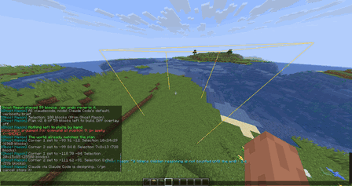

<h1 align="center">Ghost Mason</h1>

<b>Describe a build. An AI architect designs it in your world as ghost blocks.</b> 
Build along the ghosts by hand in survival, or place the whole thing in creative.

---

## What it does

Select an area, type what you want, and Ghost Mason asks an AI (Claude or DeepSeek) to design it **for that exact spot**: it sees the terrain that is there and builds around it.

- **Ghost blocks**: the design appears as see-through copies of the real blocks. Each ghost disappears once the right block is in place, so you can build it by hand.
- **Refine by talking**: `/gm refine make the roof steeper` revises the design; `/gm refine back` goes back a version.
- **See what changed**: `/gm diff` outlines what the last revision added (green), removed (red) and changed (amber).
- **Survival-friendly**: `/gm status` lists the blocks you still need next to what is in your inventory, and `/gm layer next` shows one layer at a time.
- **Place it**: in creative (or as an operator) `/gm apply` places everything; `/gm undo` and `/gm redo` work like you expect.
- **Move and rotate** a design without asking the AI again.
- **Export** to a `.schem` file for WorldEdit or Litematica.
- **WorldEdit selection**: optionally use your `//wand` selection instead of `/gm pos1`/`pos2`.
- **Sensible blocks**: panes, fences and walls connect, and torches or carpets that could not stay where the AI put them are fixed or left out before anything is placed.

## Getting started

1. Install [Fabric Loader](https://fabricmc.net/use/) and [Fabric API](https://modrinth.com/mod/fabric-api) for Minecraft **26.3**, then drop Ghost Mason into your `mods` folder.
2. In a world, look at a block and run `/gm pos1`, then look at the opposite corner and run `/gm pos2`.
3. Run `/gm build a small oak cabin with a stone chimney`.
4. The first time, Ghost Mason shows a **Connect** link in chat. It opens a page on your own computer where you pick an AI and paste a key. Then the design starts.

## Choosing an AI

| Option | What you need | Cost |
|---|---|---|
| **Claude** (default) | An Anthropic API key from the [Claude Console](https://platform.claude.com/settings/keys) | Billed per use by Anthropic |
| **DeepSeek** | An API key from the [DeepSeek platform](https://platform.deepseek.com/api_keys) | Billed per use by DeepSeek, usually cheaper |
| **Claude Code** | [Claude Code](https://code.claude.com/docs/en/setup) installed and signed in on the same computer | Uses whatever account Claude Code is signed in to |

A design typically takes 20 to 60 seconds. Switch any time with `/gm config provider <claude|deepseek|claudecode>` or `/gm config connect`.

## Commands

Everything is under `/gm`, so nothing clashes with other mods.

| Command | What it does |
|---|---|
| `/gm pos1`, `/gm pos2` | Mark the corners (the block you look at, or where you stand) |
| `/gm build <description>` | Design something in the selection |
| `/gm refine <change>` / `/gm refine back` | Revise the design / return to the previous version |
| `/gm cancel [keep]` | Stop the AI. With `keep`, the build steps it already wrote become the design; if it was still thinking, it is asked to write the build right away from its plan so far |
| `/gm apply [replace]` / `/gm undo` / `/gm redo` | Place it (needs permission, see below) and take it back. Containers in the way are kept unless you add `replace`; then they break and drop their contents |
| `/gm move <dx> <dy> <dz>` / `/gm rotate [90\|180\|270]` | Reposition the design, no AI needed |
| `/gm layer [<y>\|next\|prev\|all]` | Show one layer of ghosts at a time |
| `/gm diff [on\|off]` | Highlight what the last revision changed |
| `/gm export [name]` | Save the design as `schematics/<name>.schem` |
| `/gm status` | Progress, and the blocks you still need |
| `/gm clear [plan\|selection\|all]` | Discard the design and/or selection |
| `/gm config ...` | Settings, see below |

## Settings (`/gm config`)

`/gm config` shows the main settings; `/gm config list` shows every setting, with API keys partly hidden.

| Setting | Values | Default |
|---|---|---|
| `provider` | `claude`, `deepseek`, `claudecode` | `claude` |
| `model` | Model id, Tab shows suggestions | provider's recommended model |
| `effort` | How long the AI thinks. DeepSeek: `off`, `low`, `high`, `max`. Claude / Claude Code: `default`, `low`, `medium`, `high`, `xhigh`, `max` | DeepSeek `low`, Claude `medium`, Claude Code its own default |
| `maxtokens` | Output limit per answer for the current provider (a ceiling; you pay only for what is used) | Claude 64000, DeepSeek 524288, Claude Code its own default |
| `verbosity` | `off`, `brief` (progress and the AI's design notes), `full` (also all of its reasoning, where the provider shares it) | `brief` |
| `tokens` | `on`: live token count in the action bar while designing, final count in chat | `off` |
| `placement` | `checked` (fix or skip blocks that would fall off), `free` (place exactly as designed) | `checked` |
| `review` | `on`: the AI looks over its own result once and fixes what it finds (about twice as slow) | `off` |
| `maxvolume` | Largest selection (in blocks) sent to the AI. Bigger means longer, costlier requests | `32768` |
| `maxghosts` | Most ghosts drawn at once. Raise it for very large builds (can lower your frame rate) | `4000` |
| `ghostdistance` | How far away ghosts are drawn, in blocks | `48` |
| `worldedit` | `on`: use your WorldEdit selection (needs WorldEdit or WorldEditCUI) | `off` |

A few more settings live only in `config/ghostmason.json`.

**Your own instructions:** write anything you want the AI to always keep in mind (a favourite style, materials, "always light the inside") in `config/ghostmason-prompt.txt`. Lines starting with `#` are ignored. It is read for every request, so changes apply right away.

## Servers

Ghost Mason is mainly a client mod. Without it on the server you can still design and build along the ghosts by hand; only `/gm apply`, `/gm undo` and `/gm redo` need it on the server too.

Server owners can limit placement in `config/ghostmason-server.json`:

| Setting | Meaning | Default |
|---|---|---|
| `permission` | `op`, `creative` (ops or creative mode), `nobody`, or `auto` (creative in singleplayer, op on dedicated servers) | `auto` |
| `maxBlocksPerApply` | Most blocks one `/gm apply` may change | `20000` |
| `cooldownSeconds` | Wait between placements (operators are exempt) | `10` |
| `maxDistance` | Blocks farther from the player are refused | `256` |
| `undoDepth` | Placements per player that can be undone | `10` |

Containers (chests, furnaces...) in the way are kept by default. With `/gm apply replace` they are broken like a player would break them, so the container and its contents drop as items and nothing is lost. Undo restores the container itself, but empty.

## Privacy and costs

- Your API key is stored in `config/ghostmason.json` on your computer and is only sent to the AI provider you picked.
- Each request sends the blocks inside your selection and your description to that provider. Nothing else from your world or computer is sent.
- The connect page runs inside Minecraft on `127.0.0.1` and is only reachable from your own computer.
- AI usage is billed by the provider to your account. Larger selections cost more.

## Compatibility

- Minecraft **26.3**, Fabric Loader 0.20.1+, Fabric API, Java 25.
- Optional: WorldEdit / WorldEditCUI for selection sync.
- Other Minecraft versions are planned.

## Credits

Made by Skaffa, written together with Claude (Anthropic). The AI designs come from whichever provider you choose.

Licensed under the [MIT License](LICENSE).
